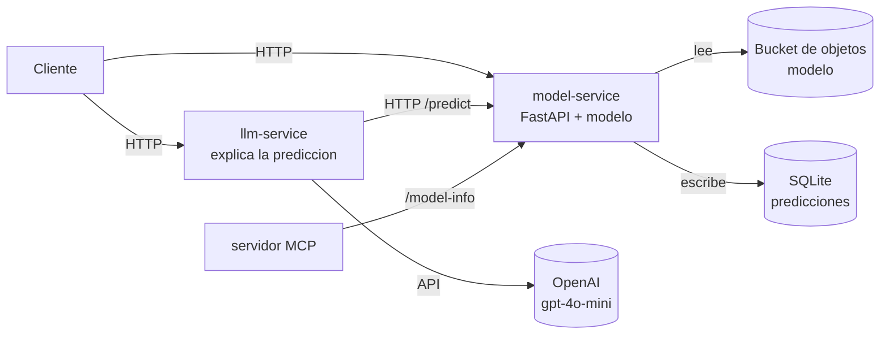
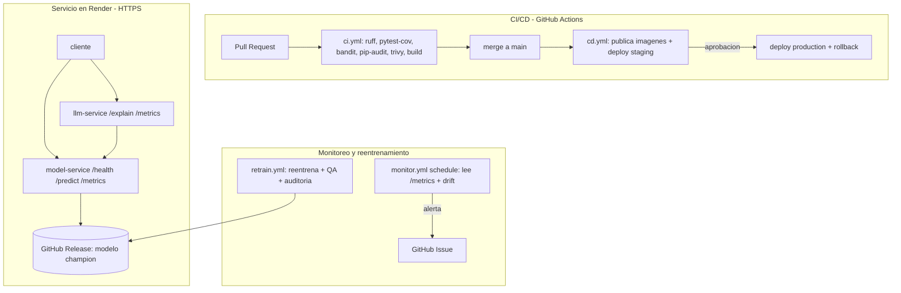

# Predicción de aumento de criminalidad (MLOps) — Entregable 1

Pipeline de entrenamiento **reproducible, probado y versionado** (código,
datos y modelo) sobre datos reales de criminalidad de la India (NCRB),
aplicando fundamentos de MLOps.

> **Objetivo de negocio.** Para cada combinación *estado × tipo de crimen*,
> predecir si los **casos registrados** del próximo año **aumentarán**
> respecto al año anterior (clasificación binaria). Permite priorizar
> recursos de prevención donde hay mayor riesgo de alza.

---

## 1. Problema y datos

| | |
|---|---|
| **Tipo** | Clasificación binaria (`target` = 1 si el valor del año supera al del año anterior) |
| **Métrica principal** | F1 de la clase positiva (ver `config/business.yaml`) |
| **Métricas secundarias** | recall, precision, ROC-AUC, PR-AUC |
| **Línea base** | `DummyClassifier` + regla de negocio de reversión a la media |

**Fuente de datos.** *CrimeBase* — estadísticas oficiales de la **National
Crime Records Bureau (NCRB)**, Gobierno de la India, publicada en Kaggle.
Se usa la tabla limpia `crime_state_year.csv` (una fila por estado × año ×
scope × crime head × métrica). Licencia según la página de Kaggle del
dataset (datos de gobierno abiertos; indicar la licencia exacta de la
versión descargada). Las tablas de noticias y documentos del mismo dataset
se reservan para el asistente RAG del Entregable 4.

> **Nota sobre fuga de datos.** Las *features* son exclusivamente históricas
> (rezagos `lag1..lag3` y sus cambios). El valor del año a predecir (`value`)
> **nunca** es feature. El escalado y la codificación se ajustan (`fit`)
> **solo con el conjunto de entrenamiento**, dentro del `Pipeline` de
> scikit-learn.

### Features del modelo
- Numéricas: `year`, `lag1`, `lag2`, `lag3`, `delta_prev` (= lag1−lag2), `pct_prev`.
- Categóricas: `state_code`, `scope`, `crime_category`.

---

## 2. Estructura del repositorio

```
.
├── config/
│   └── business.yaml        # A.1 problema de negocio
├── data/
│   ├── external/            # fuente cruda (crime_state_year.csv) — gestionado con DVC
│   ├── raw/                 # panel modelable generado — gestionado con DVC
│   └── processed/           # train/test — gestionado con DVC
├── notebooks/
│   └── 01_exploracion.ipynb # exploración
├── src/
│   ├── config.py            # carga de configuración
│   ├── ingest.py            # A.3.1 construcción del panel (rezagos + objetivo)
│   ├── validate.py          # A.3.2 validación con Pandera
│   ├── preprocess.py        # A.3.3 ColumnTransformer (sin fuga)
│   ├── data.py              # A.3.4 partición train/test
│   ├── modelos.py           # baselines + modelos
│   ├── metricas.py          # A.6 métricas
│   ├── train.py             # A.4/A.5/A.8/A.9 entrenar, optimizar, serializar, MLflow
│   └── evaluate.py          # A.6 métricas y gráficos
├── tests/                   # A.7 pruebas con pytest
├── reports/                 # comparacion.csv, metrics.json, figures/ (generados)
├── models/                  # modelo serializado (generado) — gestionado con DVC
├── params.yaml              # parámetros y espacios de búsqueda
├── dvc.yaml                 # B.2 pipeline reproducible
├── requirements.txt
├── pytest.ini
├── README.md
└── GUIA_ENTREGA.md          # pasos de Git, DVC, Pull Requests y tag v0.1.0
```

---

## 3. Instalación

Probado con **Python 3.11 / 3.12** (Linux / WSL recomendado).

```bash
python -m venv .venv
source .venv/bin/activate          # Windows: .venv\Scripts\activate
pip install -r requirements.txt
```

## 4. Obtener los datos

1. Descargue el dataset *CrimeBase (NCRB India)* de Kaggle.
2. Copie `crime_state_year.csv` a `data/external/`.

```bash
# los datos se gestionan con DVC, no con Git:
dvc add data/external/crime_state_year.csv
```

## 5. Ejecutar el pipeline

**Opción A — reproducir todo con DVC (recomendado):**

```bash
dvc repro            # ingest -> preparar -> entrenar -> evaluar
```

**Opción B — por etapas, manualmente:**

```bash
python -m src.ingest     # construye data/raw/crime_panel.csv
python -m src.data       # valida y divide train/test
python -m src.train      # compara modelos, optimiza, serializa, registra en MLflow
python -m src.evaluate   # métricas y gráficos
```

Resultados:
- `reports/comparacion.csv` — tabla de comparación de modelos (A.4).
- `reports/metrics.json` — métricas del modelo seleccionado (A.6).
- `reports/figures/` — matriz de confusión, curvas ROC y PR (A.6).
- `models/model.joblib` — modelo serializado con su preprocesamiento (A.8).

## 6. Seguimiento de experimentos (MLflow)

```bash
mlflow ui             # abrir http://127.0.0.1:5000
```
Cada corrida registra parámetros, métricas, el modelo y el commit de Git
como etiqueta (A.9).

## 7. Pruebas

```bash
pytest                # 9 pruebas (validación, partición, modelo, desempeño,
                      # reproducibilidad, serialización)
```
Las pruebas usan un panel sintético con la misma estructura, por lo que
corren sin necesidad de descargar los datos.

---

## 8. Mapeo a la rúbrica

| Requisito | Dónde |
|---|---|
| A.1 Problema en configuración | `config/business.yaml` |
| A.2 Organización del repo | estructura + `requirements.txt` + `.gitignore` + este README |
| A.3 Ingesta / validación / preprocesamiento / partición | `src/ingest.py`, `src/validate.py` (Pandera), `src/preprocess.py` (ColumnTransformer), `src/data.py` |
| A.4 Baseline + 2 modelos + comparación | `src/train.py` → `reports/comparacion.csv` |
| A.5 Optimización de hiperparámetros | `src/train.py` (RandomizedSearchCV), espacio en `params.yaml` |
| A.6 Métricas + gráficos | `src/evaluate.py` → `reports/metrics.json`, `reports/figures/` |
| A.7 ≥5 pruebas con pytest | `tests/` (9 pruebas) |
| A.8 Serialización + prueba de carga | `src/train.py` (joblib) + `tests/test_serializacion.py` |
| A.9 Seguimiento con MLflow | `src/train.py` (params, métricas, modelo, commit) |
| B.1/B.2/B.3 Versionamiento y entrega | ver `GUIA_ENTREGA.md` |

## Resultados obtenidos

Modelo seleccionado: Random Forest.

| Métrica | Valor |
|---|---|
| F1 | 0.658 |
| ROC-AUC | 0.757 |
| Precision | 0.665 |
| Recall | 0.652 |

Ver `reports/` para la tabla de comparación completa y los gráficos.

## Licencia y fuente de los datos
Dataset: CrimeBase — estadisticas de criminalidad de la NCRB (National Crime Records Bureau, Government of India), obtenido via Kaggle.
Licencia: ver la pagina del dataset en Kaggle (datos gubernamentales de acceso abierto). Indicar aqui la licencia exacta que muestre Kaggle (por ejemplo "CC0: Public Domain" u "Other").

---

# Entregable 2 — Nube, APIs, microservicios y contenedores

Expone el modelo del Entregable 1 como un **servicio web (API)**, lo
empaqueta en **contenedores** y lo despliega en la **nube**, más un servicio
con **LLM** que explica las predicciones y un prototipo de **servidor MCP**.

## Arquitectura



Dos microservicios con funciones separadas: **model-service** (la API del
modelo) y **llm-service** (explicación en lenguaje natural). Se levantan
juntos con `docker compose up`.

## Servicios y endpoints

**model-service** (puerto 8000):

| Método | Ruta | Descripción |
|---|---|---|
| GET | `/health` | Estado del servicio y del modelo |
| GET | `/model-info` | Versión y métricas del modelo |
| POST | `/predict` | Predicción de un registro |
| POST | `/predict/batch` | Predicción de una lista (máx. 500) |
| WS | `/ws/predict` | Predicciones por WebSocket |
| GET | `/docs` | Documentación automática (Swagger) |

**llm-service** (puerto 8001):

| Método | Ruta | Descripción |
|---|---|---|
| GET | `/health` | Estado y modo (openai / mock) |
| POST | `/explain` | Explica una predicción (respuesta en streaming) |

## Cómo ejecutar en local

```bash
cp .env.example .env         # completa OPENAI_API_KEY (o pon LLM_MOCK=true)
# Asegúrate de tener el modelo en models/model.joblib (del Entregable 1:
#   dvc repro   ó   python -m src.train)
docker compose up --build
```

- API:            http://localhost:8000/health
- Documentación:  http://localhost:8000/docs
- Servicio LLM:   http://localhost:8001/health

### Ejemplos de consumo (curl)

```bash
# Predicción
curl -X POST http://localhost:8000/predict \
  -H "Content-Type: application/json" \
  -d '{"state_code":"MH","scope":"ipc","crime_category":"murder","year":2022,"lag1":300,"lag2":250,"lag3":240}'

# Explicación en lenguaje natural (streaming)
curl -N -X POST http://localhost:8001/explain \
  -H "Content-Type: application/json" \
  -d '{"state_code":"MH","scope":"ipc","crime_category":"murder","year":2022,"lag1":300,"lag2":250}'
```

También hay ejemplos en `requests.http` (extensión REST Client de VS Code).

## Pruebas

```bash
pytest tests/test_api.py tests/test_llm.py -v
```

## Contenedores e imágenes

Cada servicio tiene su `Dockerfile` (`Dockerfile.api`, `Dockerfile.llm`) con
imagen base fija (`python:3.12-slim`), usuario no root y `HEALTHCHECK`.
Las imágenes se publican etiquetadas con la versión `0.2.0`:

```bash
docker build -f Dockerfile.api -t <registro>/model-service:0.2.0 .
docker build -f Dockerfile.llm -t <registro>/llm-service:0.2.0 .
docker push <registro>/model-service:0.2.0
docker push <registro>/llm-service:0.2.0
```

## Despliegue en la nube (DigitalOcean)

Infraestructura como código en dos variantes:
- **`scripts/deploy.sh`** — crea los recursos con la CLI (`doctl` + `aws` para Spaces).
- **`infra/`** — lo mismo con **Terraform** (`terraform init / plan / apply / destroy`).

### Recursos creados (completar tras el despliegue)

| Recurso | Tipo | Región | Tamaño | Puertos |
|---|---|---|---|---|
| Bucket del modelo | Spaces (S3) | nyc3 | — | privado |
| Cómputo | Droplet (Docker) | nyc3 | s-1vcpu-1gb | 8000, 8001 |
| Red | Firewall | nyc3 | — | 22, 8000, 8001 |

**URL pública del servicio:** `http://<IP-del-droplet>:8000`  *(completar)*

> El modelo NO va dentro de la imagen: el servicio lo descarga del bucket al
> iniciar (variable `MODEL_S3_URI`), así se puede actualizar sin reconstruir
> el contenedor. Las credenciales se pasan por variables de entorno (`.env`),
> nunca en el código.

## Servidor MCP (prototipo)

`mcp_server/server.py` expone la herramienta `obtener_info_modelo`. Se prueba
con el MCP Inspector:

```bash
pip install "mcp<2"
npx @modelcontextprotocol/inspector python -m mcp_server.server
```

Herramientas planeadas para el Entregable 4 (anotadas en el código):
`predecir` y `consultar_documentos` (RAG sobre noticias/documentos).

## Costos

Se usó la capa/crédito gratuito (GitHub Student Pack en DigitalOcean) con una
**alerta de presupuesto** configurada. **Al terminar la revisión, elimine los
recursos** (`terraform destroy`, o borre el Droplet, el firewall y el bucket)
para evitar cobros.

## Despliegue en producción (Entregable 2)

- **API del modelo (público):** https://model-service-88hd.onrender.com  (`/health`, `/predict`, `/docs`)
- **Servicio LLM (público):** https://llm-service-zsui.onrender.com  (`/explain`)
- **Imágenes publicadas (GitHub Container Registry):**
  - `ghcr.io/cuberojuanpablo065-png/model-service:0.2.0`
  - `ghcr.io/cuberojuanpablo065-png/llm-service:0.2.0`
- **Proveedor:** Render.com (capa gratuita). El modelo se descarga al iniciar
  desde un GitHub Release (asset `model.joblib`), no va dentro de la imagen.

---

# Entregable 3 — CI/CD, monitoreo, reentrenamiento y seguridad

Automatiza pruebas y despliegue con **GitHub Actions**, monitorea el servicio,
reentrena el modelo con control de calidad y aplica controles de seguridad.

> **Dataset (enlace exacto de Kaggle):** `https://www.kaggle.com/datasets/rajanand/crime-in-india`
> Fuente oficial: **NCRB** (National Crime Records Bureau, Government of India).
> El archivo fuente `data/external/crime_state_year.csv` se versiona con DVC
> (`dvc add data/external/crime_state_year.csv`); no se sube a Git.

## Correcciones aplicadas (feedback de E1 y E2)

- **División temporal** (no aleatoria): se entrena con los años más antiguos y
  se prueba con los más recientes (`split.tipo: temporal`, `anio_corte_test`).
  Además se **quitó `year` como variable** para no inflar el desempeño.
- **Selección por validación cruzada**, no con el conjunto de prueba: el modelo
  se elige por `cv_f1` sobre train; el test es solo reporte final.
- **Prueba de desempeño del modelo real** (`tests/test_desempeno_real.py`), que
  evalúa el modelo serializado sobre el test real.
- **`/model-info`** ahora muestra las métricas (el meta siempre las incluye).
- **Integridad SHA-256**: el servicio verifica el hash del modelo al cargarlo y
  no lo usa si no coincide.

## Arquitectura (lo realmente implementado)



- **Despliegue real:** Render.com (HTTPS lo provee Render). La redundancia con
  **Nginx + 2 réplicas** se demuestra localmente con `docker-compose.redundancia.yml`.
- **Champion:** el modelo promovido se publica como asset del GitHub Release y el
  servicio lo descarga al iniciar (sin reconstruir la imagen). El Terraform de
  `infra/` (DigitalOcean) es una alternativa de referencia, no el despliegue en uso.

## Parte A — Integración continua
`.github/workflows/ci.yml` corre en cada PR: ruff, pytest con cobertura (≥60%,
LLM en mock), validación de datos y umbral, build de imágenes y análisis estático
(Bandit, pip-audit, Trivy). Plantilla de PR en `.github/pull_request_template.md`.
Proteger `main` para bloquear la fusión si el CI falla (Settings → Branches).

## Parte B — Entrega continua
`.github/workflows/cd.yml`: al fusionar en `main` publica imágenes con la etiqueta
del commit en GHCR, despliega en **staging** y verifica `/health` y `/predict`.
**production** requiere aprobación (ambiente de GitHub) y hace **rollback** si la
verificación falla. Ambientes `staging` y `production` con sus secretos.

## Parte C — Monitoreo y QA
- `GET /metrics` en ambos servicios (solicitudes, errores, latencia; distribución
  de predicciones; tokens y costo en el LLM).
- `scripts/drift_report.py` compara las predicciones registradas con los datos de
  entrenamiento (PSI), umbral en `config/drift.yaml`.
- `scripts/simular_drift.py` envía datos modificados para simular drift.
- `.github/workflows/monitor.yml` (schedule) lee `/metrics`, evalúa drift/latencia
  y abre un **Issue** como alerta.
- `config/qa_gates.yaml` define las condiciones para reemplazar el modelo.

## Parte D — Reentrenamiento y auditoría
`.github/workflows/retrain.yml` (manual y programado) ejecuta
`scripts/reentrenar.py`: reentrena, evalúa las condiciones de QA; si cumple,
promueve el candidato a **champion** y lo publica en el Release; si no, conserva
el actual. Genera `reports/auditoria_reentrenamiento.json` (fecha, disparador,
commit, versión, decisión) como artefacto.

## Parte E — Seguridad
- **Análisis estático** en el CI (Bandit, pip-audit, Trivy) y **dinámico** (OWASP
  ZAP contra staging; ver más abajo).
- **Validación** con Pydantic `extra="forbid"` y límite de tamaño de lote.
- **Autenticación** por API key (`API_KEY`) y **límite de tasa** por IP.
- **HTTPS** (Render) e **integridad SHA-256** del modelo.
- **Carga** con Locust (`locustfile.py`, dos niveles) y **redundancia** con Nginx
  (`docker-compose.redundancia.yml`): se detiene una réplica y el servicio sigue.

### Comandos útiles
```bash
# Pruebas con cobertura
pytest --cov=app --cov=src --cov=llm_service --cov-report=term

# Redundancia (Nginx + 2 réplicas)
docker compose -f docker-compose.redundancia.yml up -d --build
# en otra terminal, carga:
locust -f locustfile.py --headless -u 50 -r 10 -t 1m --host http://localhost:8080 --html reports/locust.html
# detener una réplica y verificar que sigue respondiendo:
docker compose -f docker-compose.redundancia.yml stop model-b
curl http://localhost:8080/health

# Análisis dinámico (OWASP ZAP) contra staging:
docker run --rm ghcr.io/zaproxy/zaproxy:stable zap-baseline.py -t https://TU-STAGING.onrender.com
```
